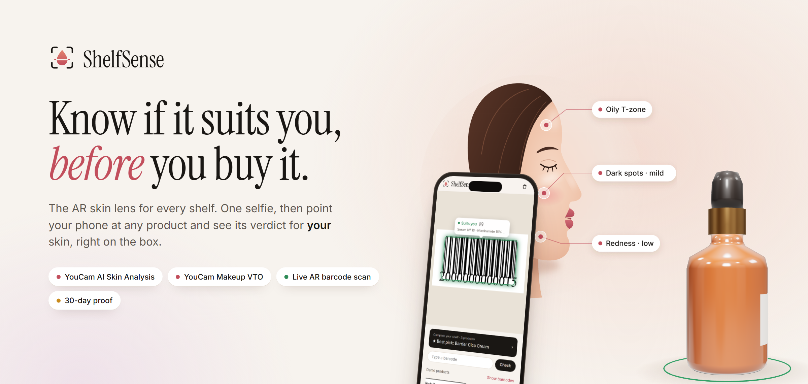
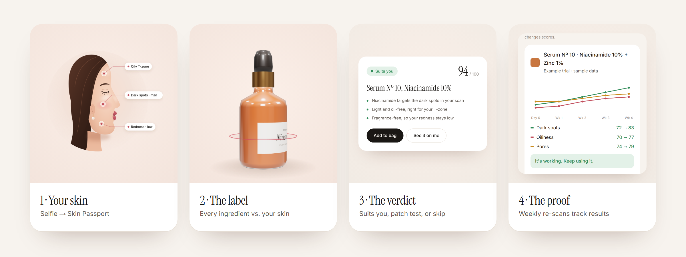
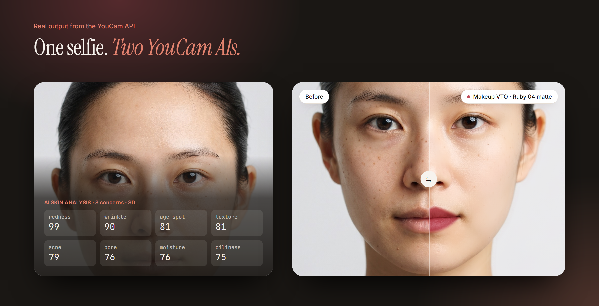
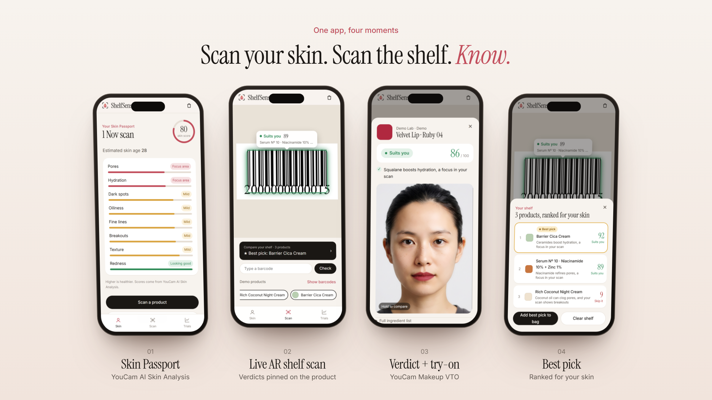
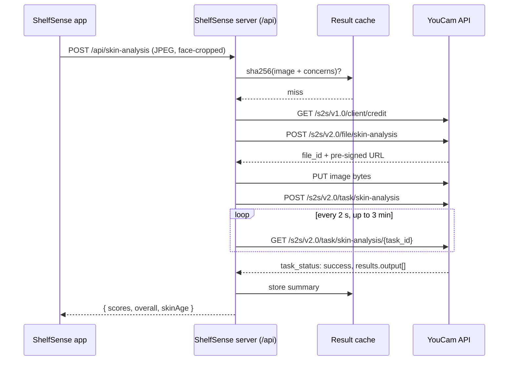
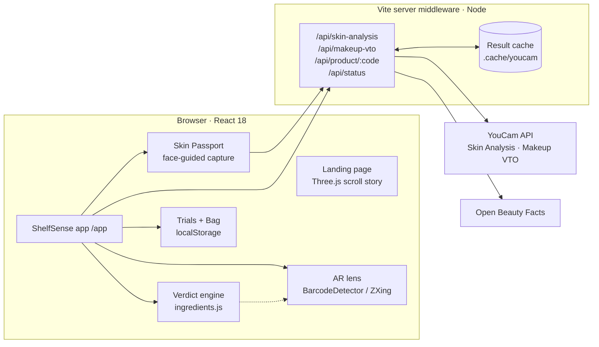

<p align="center">
  
</p>

<p align="center">
  
  
  
  <br>
  
  
  
  
  
</p>

<h3 align="center">One selfie. Any product. Any shelf. <i>Know if it suits your skin, before you buy it.</i></h3>

<p align="center">
  Built for the <a href="https://youcam-api-skin-ai-ecommerce.devpost.com/"><b>YouCam API Skin AI &amp; eCommerce Hackathon 2026</b></a> by Perfect Corp.
</p>

---

## Contents

- [The problem](#the-problem)
- [The idea](#the-idea)
- [Real YouCam output](#real-youcam-output)
- [Features](#features)
- [How ShelfSense uses the YouCam API](#how-shelfsense-uses-the-youcam-api)
- [The live AR shelf lens](#the-live-ar-shelf-lens)
- [The verdict engine](#the-verdict-engine)
- [Architecture](#architecture)
- [Run it locally](#run-it-locally)
- [Privacy and responsible AI](#privacy-and-responsible-ai)
- [Roadmap](#roadmap)

---

## The problem

Standing in front of a beauty shelf, a shopper has two sources of truth: the marketing on the box, and an ingredient list written in INCI. Neither one knows **their** skin. So people guess, buy, try, and often return or abandon products that were never right for them.

Most skin-AI apps only recommend products from their own catalog. The moment you walk into a real store, they can't help.

## The idea

**ShelfSense turns YouCam's skin intelligence into a lens you can point at any product, in any store.**

<p align="center"></p>

| Step | What happens | Powered by |
|---|---|---|
| **1 · Your skin** | One selfie becomes a private **Skin Passport**: 8 concerns, an overall score and skin age. | **YouCam AI Skin Analysis** |
| **2 · The label** | Point your phone at a barcode. ShelfSense reads the full ingredient list. | Live AR lens + Open Beauty Facts |
| **3 · The verdict** | *Suits you*, *Patch test first*, or *Skip it*, pinned onto the product in AR, with reasons drawn from **your** scan. For lipstick, see the exact shade on your face. | Verdict engine + **YouCam Makeup VTO** |
| **4 · The proof** | Start a 30-day trial. A weekly selfie re-scans your skin, so you see whether the product really works. | **YouCam AI Skin Analysis** |

## Real YouCam output

Everything below is **unedited output from the YouCam API**, called through ShelfSense's own backend: one selfie in, eight skin scores and a lipstick render out.

<p align="center"></p>

## Features

<p align="center"></p>

| | Feature | Details |
|---|---|---|
| 🧬 | **Skin Passport** | Selfie with a face-oval guide, auto-cropped to the face so YouCam always gets a usable image. 8 concerns ranked worst-first as *Focus area*, *Mild* or *Looking good*. |
| 📷 | **Live AR shelf lens** | Real-time barcode detection. A verdict tag and tracking frame stick to each product and glide with the camera. |
| ★ | **Best pick on the shelf** | Scan several products and ShelfSense crowns the one that suits you best, in AR and in a ranked compare sheet. One tap adds it to your bag. |
| 💄 | **See it on me** | For lipsticks and foundations, YouCam Makeup VTO renders the exact shade on your selfie. Hold to compare before/after. |
| 🧪 | **Reasons, not just scores** | Every verdict explains itself: *"Coconut oil can clog pores, and your scan shows breakouts."* |
| 📈 | **30-day proof** | Trials re-scan your skin weekly and chart the concerns the product targets. It refuses to judge before week 3, because actives need time. |
| 🛍️ | **Bag** | Add to bag from any verdict or from the best pick, with each item's verdict shown. |
| 🛟 | **Credit-aware demo mode** | When credits run low, the app keeps working with clearly labelled simulated scores, and replays any cached real result for free. |

## How ShelfSense uses the YouCam API

ShelfSense is built around two YouCam AIs, and treats them as production infrastructure rather than a demo call.

### APIs used

| YouCam API | Endpoints | Used for |
|---|---|---|
| **AI Skin Analysis** (v2.0, SD) | `POST /s2s/v2.0/file/skin-analysis` → `PUT` pre-signed URL → `POST /s2s/v2.0/task/skin-analysis` → `GET /s2s/v2.0/task/skin-analysis/{task_id}` | Skin Passport and every trial check-in. Concerns requested: `acne`, `age_spot`, `redness`, `oiliness`, `pore`, `moisture`, `texture`, `wrinkle`, with `format: "json"`. |
| **AI Makeup Virtual Try-On** (v2.0) | `POST /s2s/v2.0/file/makeup-vto` → `PUT` → `POST /s2s/v2.0/task/makeup-vto` → poll | *See it on me* with `lip_color` and `foundation` effects built from each product's shade. |
| **Client credit** (v1.0) | `GET /s2s/v1.0/client/credit` | Free balance check before every paid call. |

### Request flow



### Engineering details

- **The key never reaches the browser.** The YouCam key lives in `.env.local` and is used only by the server middleware in [`server/`](server/). The client calls ShelfSense's own `/api/*` routes.
- **Faithful to the v2 flow.** File registration, a `PUT` to the pre-signed URL using the headers YouCam returns, task creation, and polling on `task_status` until `success` or `error`.
- **Resilient.** HTTP 429 is retried with backoff. Task errors such as `error_src_face_too_small`, `error_large_face_angle` and `error_no_face` become plain-language tips, and the user lands straight back on the camera to retake.
- **Built for YouCam's input requirements.** The selfie is cropped to the on-screen face guide and upscaled to at least 720 px on the short side. In testing, this turned `error_src_face_too_small` on wide laptop webcam frames into successful analyses.
- **Calibrated to real output.** Real `ui_score` values cluster between 70 and 99 (higher is healthier), so severity is mapped onto that range rather than assuming 0–100.
- **Results downloaded at once.** VTO result URLs expire after about 2 hours, so the server downloads the image and returns it inline.
- **Never pay twice.** Every real result is cached on disk by a SHA-256 of the image and request, so repeated demos cost nothing.
- **Unit-aware.** Measured cost: **12 units** per 8-concern SD analysis and **1 unit** per makeup try-on. The server checks the balance (free) before each paid call. Below the threshold it switches to demo mode, which is always labelled in the UI, instead of failing.

The full client is ~120 lines: [`server/youcam.js`](server/youcam.js).

## The live AR shelf lens

- **Detection:** the native `BarcodeDetector` where available (Android Chrome, macOS), falling back to **ZXing** everywhere else. EAN-13, EAN-8, UPC-A, UPC-E and Code 128.
- **Anchoring:** each detection's box is mapped from video pixels to screen space, accounting for `object-fit: cover`, and eased between frames so tags glide instead of jumping.
- **Tracking:** tags fade when a barcode leaves view and disappear after 2.5 s. On devices with the native detector, several products can be tagged at once.
- **Product data:** real barcodes resolve through [Open Beauty Facts](https://world.openbeautyfacts.org/). Six demo products with printable EAN-13 barcodes (prefix `200`, reserved for in-store use) make demos reliable anywhere.

## The verdict engine

[`src/app/ingredients.js`](src/app/ingredients.js) holds ~30 transparent ingredient rules. Each rule lists the YouCam concerns an ingredient **helps** (niacinamide → dark spots, oiliness, pores) or may **aggravate** (coconut oil → breakouts, pores).

1. Each concern's **severity** comes from the user's own YouCam `ui_score`.
2. Benefits are weighted by how much that concern matters for this person, with diminishing returns so stacking actives doesn't saturate the score.
3. Irritants and pore-cloggers are weighted by the concerns they could worsen.
4. The result is a score from 0 to 100 and a verdict: **Suits you** (≥ 72), **Patch test first** (50–71), or **Skip it** (< 50).
5. Every verdict comes with reasons tied to the scan, each naming a different concern where possible.

> ShelfSense gives consumer guidance, not medical advice. The rules are deliberately simple and readable so anyone can audit them.

## Architecture



| Layer | Stack |
|---|---|
| Frontend | React 18, Vite 6, plain CSS with design tokens |
| 3D | Three.js (procedural glass bottle with orbiting ingredient tags, interactive 3D shelf with a live AR lens) |
| AR | `getUserMedia`, `BarcodeDetector`, `@zxing/browser` |
| Backend | Node 24 middleware inside the Vite dev/preview server |
| AI | **YouCam AI Skin Analysis**, **YouCam Makeup VTO** |
| Data | Open Beauty Facts, demo catalog |

## Run it locally

**Requirements:** Node.js 20+ and a YouCam API key from the YouCam API console.

```bash
git clone <this repo>
cd shelfsense
npm install
echo "YOUCAM_API_KEY=sk-..." > .env.local
npm run dev            # http://localhost:5173  ·  app at /app
```

**On a phone (camera needs HTTPS):**

```bash
npm run dev:phone      # https://<your-LAN-IP>:5173/app  (accept the self-signed certificate)
```

**Try the AR lens without products:** open **Scan → Show barcodes** on one screen and scan it with another device. Or tap a demo product, or type any real barcode.

| Variable | Purpose |
|---|---|
| `YOUCAM_API_KEY` | Your YouCam key (server-side only) |
| `YOUCAM_DEMO=1` | Never call YouCam; use labelled simulated scores (for UI work) |

<details>
<summary><b>Project structure</b></summary>

```
server/
  youcam.js          YouCam v2 client: upload, task, poll, retry
  api.js             /api routes, cache, credit-aware demo mode, product lookup
src/
  App.jsx            landing page
  components/        landing sections, 3D bottle, 3D shelf lens, illustrated portrait, logo
  app/
    ShelfApp.jsx     the app shell (/app)
    Passport.jsx     Skin Passport
    SelfieCapture.jsx face-guided capture + crop
    Scanner.jsx      live AR lens + best pick
    VerdictSheet.jsx verdict, reasons, YouCam try-on
    Compare.jsx      ranked shelf
    Trials.jsx       30-day proof
    ingredients.js   verdict engine
    catalog.js       demo products + VTO effects
docs/                README images
```
</details>

## Privacy and responsible AI

- The selfie is sent to YouCam **only** for analysis or try-on. The Skin Passport, trials and bag stay in the browser's local storage.
- The API key is server-side only. `.env.local` and the result cache are git-ignored.
- Simulated scores are **always labelled** as such in the UI; they are never shown as real AI output.
- Verdicts are guidance, not diagnosis. Trials warn that lighting changes scores and refuse to judge too early.

## Roadmap

- **Retailer widget:** one script tag that adds the ShelfSense lens to any product page.
- **Put-back insights:** anonymous data on why shoppers skip a product (ingredient, shade, skin concern).
- **YouCam Skin Tone Analysis** for undertone-aware foundation matching.
- **Routine clash checker** (retinol + AHA, benzoyl peroxide + retinol) and AM/PM ordering.
- **Voice verdicts** for hands-free and low-vision shopping.
- Label OCR for products missing from Open Beauty Facts.

## Credits

- **YouCam API by Perfect Corp.** for AI Skin Analysis and Makeup Virtual Try-On.
- [Open Beauty Facts](https://world.openbeautyfacts.org/) for product and ingredient data (ODbL).
- The sample face in the YouCam demo images is from the open-source [skinmatch](https://github.com/kimdooo-a/skinmatch) project (MIT).
- Typefaces: [Instrument Serif](https://fonts.google.com/specimen/Instrument+Serif) and [Inter](https://fonts.google.com/specimen/Inter) (SIL OFL).

<p align="center">
  <br>
  <sub><b>ShelfSense</b> · Know before you buy.</sub>
</p>
